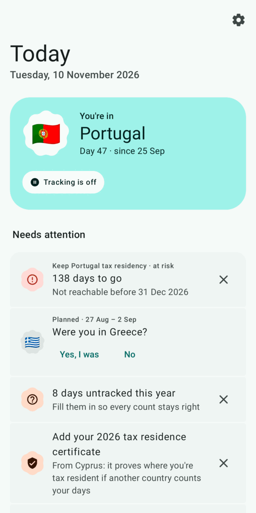
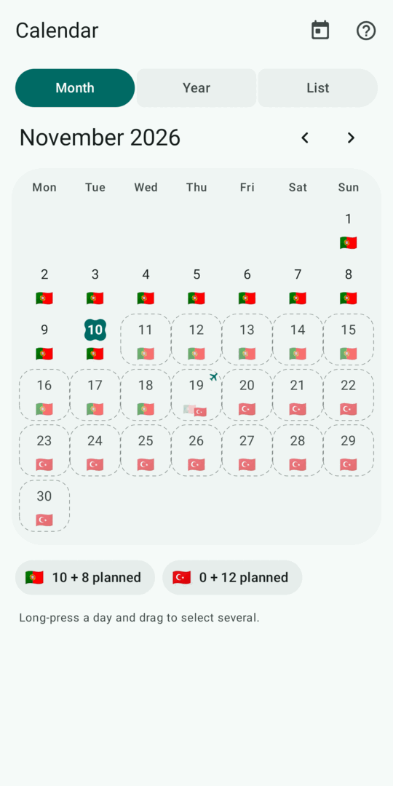
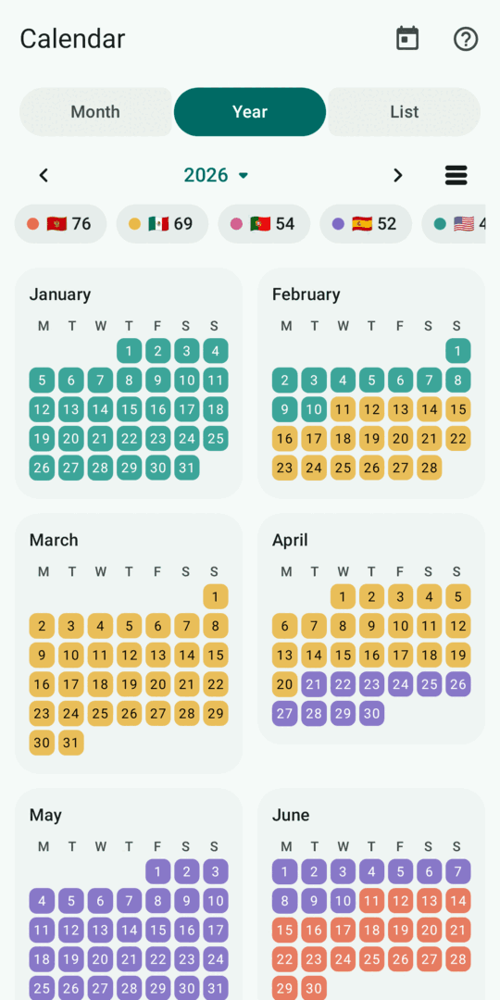
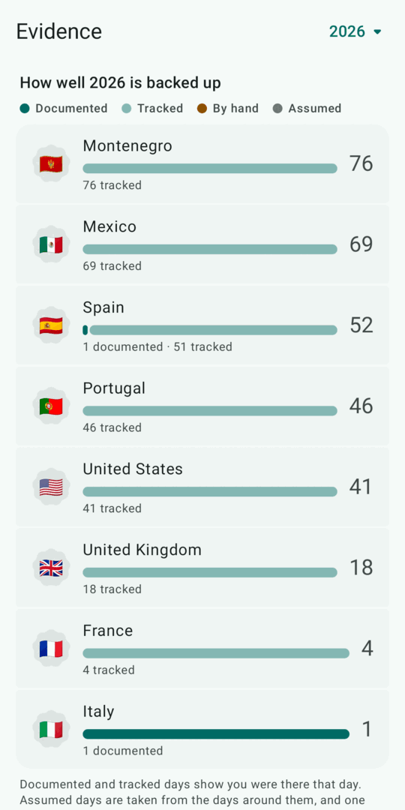

<div align="center">

# Sojourn

**Know where you've been, plan where you're going, and prove it.**

An Android app for digital nomads, expats and anyone whose taxes or visas depend on how many
days they spend where. It runs offline and has no internet permission.







</div>

## Three tabs, three questions

| Tab | Question | What's there |
| --- | --- | --- |
| **Today** | *Where do I stand?* | Where you are now, what needs attention, every rule's status, your next flight, this year by country |
| **Calendar** | *What happened?* | Month, Year and List views of your days. One day sheet everywhere with countries, flights and evidence |
| **Evidence** | *Can I prove it?* | Coverage per country, a checklist of documents worth having, every kept document, the evidence pack and reports |

Settings, Rules and Import open from wherever they're needed. Every change, from any screen, can
be undone.

## What it does

### Counts days on its own
A coarse location every few hours (never GPS), a check whenever the time zone changes, and the
mobile network's country as a fallback. You can also use the mobile network alone, with no
location permission at all, or turn off background tracking.

### Counts them the way each country does
Spain counts any moment on its soil, the UK counts where you are at midnight, Cyprus counts the
day you arrive but not the day you leave, and Korea starts from the day after arrival. Sojourn
knows how about **60 countries** count a travel day. It works out the order of a travel day's
countries and never counts airside transit. You can override any country under
*Settings › Counting*.

### Tracks tax residency, with every test a country has
Cyprus's 183-day and 60-day rules, Ireland's 280 days over two years, the UK's statutory
residence test with its ties, India's 60 + 365 days, the US substantial presence test, rolling
12-month windows and consecutive stays such as Germany's six months. Tests that depend on facts
only you know (a home, a job, the centre of your interests) ask you. Until you answer, they say
*"resident if…"*. Spain also shows the count with sporadic absences. Every rule cites its source
and says how sure Sojourn is.

### Tracks limits for wherever you're from
Schengen 90/180, residence continuity (never more than 6 months away in a row, as EU long-term
residence and citizenship require), visa-free stays, or any custom rule. Limits know your
passports and residence permits, so an EU citizen is never counted against Schengen. Each rule
shows days left, when days free up and how long you could stay from tomorrow. It warns you
before you reach the limit.

### Plans ahead
Planned stays and flights are checked against every rule before you book. The Calendar's Year
view mixes lived and planned days into a forecast.

### Keeps flights
Add a flight by number, date and airports (searched offline in a built-in list of the world's
airports), or paste a boarding pass or booking confirmation. Flights keep their booking
reference, passenger and seat. Departure and arrival become travel days, and no flight lookup
service is involved.

### Keeps evidence
Boarding passes, receipts, rental contracts, utility bills and residence certificates. Each
kind of document has a strength that follows what tax authorities and courts accept. Days
between a kept boarding pass into a country and the next one out of it count as documented. The
Evidence tab shows how well each country's days are backed up. Before you export the year's
evidence pack (a summary, every day and every document), it checks what's missing.

### Imports trips
Imports trips from flights in your calendars (like those Gmail adds from booking emails),
boarding pass screenshots, PDF boarding passes, Apple Wallet passes, `.ics` files, single emails,
or a whole Google Takeout mailbox, whose schema.org markup gives flights, trains, buses, ferries
and hotels. Set your name and bookings made for someone else are left out.

### Fills in the past
Fills in past days from where your photos were taken, GPX tracks (Strava, Komoot, Garmin…) or a
Google Timeline export (on-device `Timeline.json`, Takeout's `Records.json` and Semantic Location
History, the iOS export, or the whole Takeout zip). Only countries are kept, and you approve each
stay found.

### Reports, widget and backups
- **Travel history** for visa, residence and citizenship applications (or Global Entry).
- **Form 2555** (FEIE physical presence) for US filers, with the best 12-month period and the
  line 18 travel table as CSV.
- **Home screen widget** with the current country, days there this year and the closest limit.
- **Backups**: one zip with everything, evidence files included, to export or restore (merge
  or replace). Unzipped, it reads without Sojourn: CSVs of days, flights and documents, and the
  files in a folder per kind. Automatic weekly backups go into any folder (e.g. one synced by
  Syncthing), and Android's own backup works too.

## Private by design

> [!NOTE]
> The app has **no `INTERNET` permission**. Countries are found on the phone from built-in
> [Natural Earth](https://www.naturalearthdata.com/) borders (`app/src/main/assets/borders.bin`,
> about 11 m precision). Only the country is ever stored, never coordinates.

## Building

Everything builds in a container. The host needs only `make` and Docker or Podman.

```sh
make debug        # app/build/outputs/apk/debug/app-debug.apk
make test         # unit tests: day counting, rules, reports, country lookup, backups, import
make screenshots  # renders every screen to app/build/screenshots
make verify       # tests, debug build and lint
make release      # shrunk, signed release APK: sojourn-<date>.apk
make publish      # tags today's version; GitHub Actions publishes the signed APK
```

Every build is numbered by its date and hour (`versionCode` 2026102513, `versionName`
2026.10.25), so each one installs as an update of the last. Debug builds are a separate app
(`app.sojourn.debug`) and can be installed next to a release.

<details>
<summary><strong>Signing</strong></summary>

Debug builds are signed with `debug.keystore`, a public key kept in the repository on purpose.
Otherwise Gradle would create a new key inside every build container, and Android refuses an
update signed with a different key.

Releases are signed with a private key that never enters the repository:

1. `make release-key` creates `signing/release.jks`. It asks for a password or takes it from
   `SOJOURN_KEYSTORE_PASSWORD`.
2. Back up `signing/release.jks` and its password somewhere safe. If you lose either, no update
   can ever be installed over a release again.
3. `make release` builds and signs. The password comes from `SOJOURN_KEYSTORE_PASSWORD`, then
   from `signing/release.password` if that file exists. Otherwise it asks for it.

`make publish` releases through GitHub instead: it pushes a `v<date>` tag, and the
[Release workflow](.github/workflows/release.yml) runs the tests, builds, signs with the same key
and attaches `sojourn-<date>.apk` to a GitHub release. A second release on the same day needs an
annotated tag of its own (`git tag -a v2026.11.10.2`) made in a later hour: the version code is
the hour the tag was made. The workflow takes the key from the `release` environment's secrets,
`SOJOURN_KEYSTORE_BASE64` and `SOJOURN_KEYSTORE_PASSWORD`, and refuses to publish an APK signed
with any other certificate.

</details>

<details>
<summary><strong>Regenerating assets</strong></summary>

- `make geodata NE=…/ne_50m_admin_0_countries.geojson` rebuilds the border assets from a
  [Natural Earth](https://www.naturalearthdata.com/) download.
- `make icon` regenerates the launcher, themed and notification icons from
  `tools/build_icon.py`.
- `python3 -I tools/build_airports.py airports.csv app/src/main/assets/airports.tsv` refreshes
  the airport list from [OurAirports](https://ourairports.com/data/) (public domain).

</details>

## Layout

```
app/src/main/java/app/sojourn/
├── domain/     pure Kotlin: DayBook, Counting, CountryRules, Residency, RuleEngine, Reports
├── data/       Room database, DataStore settings, backup format, offline country lookup
│   └── travel/ trip import: BCBP barcodes, schema.org, MIME/mbox, iCalendar, passenger names
├── tracking/   the background check, alerts, automatic backups, photo scanning
├── ui/         Compose with Material 3 Expressive, one package per screen
└── widget/     the Glance home screen widget
```

The structure and wording rules behind the UI are in [`docs/ui-redesign.md`](docs/ui-redesign.md).
